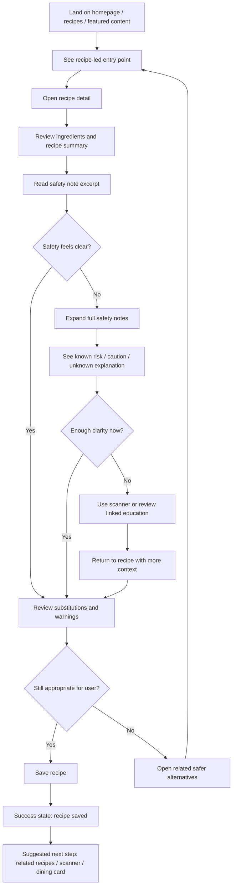
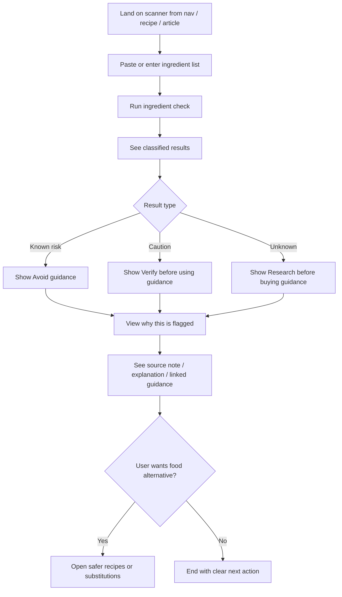
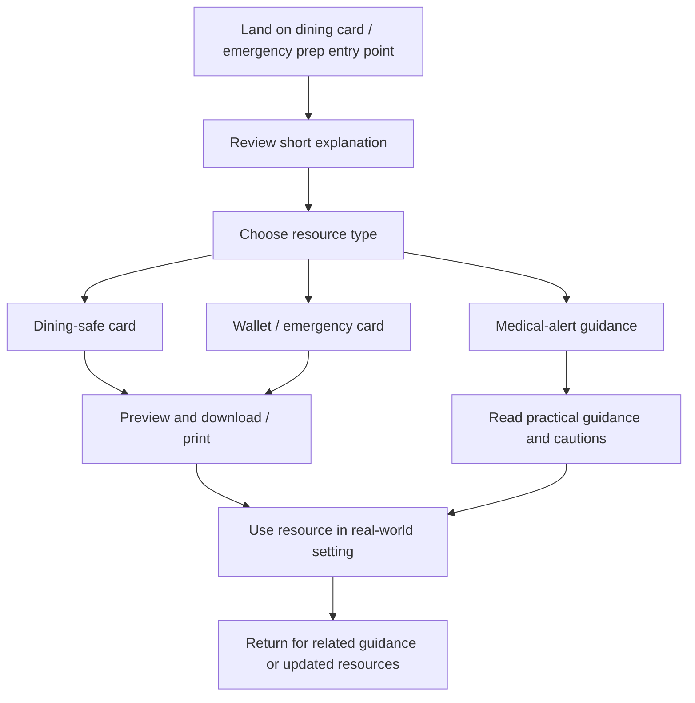

---
stepsCompleted:
  - 1
  - 2
  - 3
  - 4
  - 5
  - 6
  - 7
  - 8
  - 9
  - 10
  - 11
  - 12
  - 13
  - 14
lastStep: 14
inputDocuments:
  - /home/shawnmonk/monk/collection/alphagaldata/_bmad-output/planning-artifacts/prd.md
  - /home/shawnmonk/monk/collection/alphagaldata/_bmad-output/project-context.md
  - /home/shawnmonk/monk/collection/alphagaldata/docs/index.md
  - /home/shawnmonk/monk/collection/alphagaldata/docs/project-overview.md
  - /home/shawnmonk/monk/collection/alphagaldata/docs/architecture.md
  - /home/shawnmonk/monk/collection/alphagaldata/docs/component-inventory.md
  - /home/shawnmonk/monk/collection/alphagaldata/docs/api-contracts.md
  - /home/shawnmonk/monk/collection/alphagaldata/docs/data-models.md
  - /home/shawnmonk/monk/collection/alphagaldata/docs/development-guide.md
  - /home/shawnmonk/monk/collection/alphagaldata/docs/deployment-guide.md
  - /home/shawnmonk/monk/collection/alphagaldata/docs/source-tree-analysis.md
---

# UX Design Specification alphagaldata

**Author:** Monk
**Date:** 2026-04-16

---

## Executive Summary

### Project Vision

AlphaGalData is a public, content-first web experience that helps people living with alpha-gal make safer day-to-day decisions around food, label reading, dining, testing, and medical-alert preparation. The UX should make high-trust guidance feel practical, calm, and usable, with featured recipes serving as the primary trust-building entry point.

### Target Users

The primary users are long-time alpha-gal patients who still struggle with food choices and want practical help beyond generic allergy advice. Secondary users are caregivers who need clear, confidence-building guidance to shop, cook, and support someone living with alpha-gal safely. Operational users are the trusted moderators and editors who maintain content quality, feature key resources, and prevent unsafe submissions from going public.

### Key Design Challenges

The UX must reduce cognitive overload while presenting safety-critical information. It must connect recipes, scanner flows, downloads, and education into a coherent experience rather than a collection of separate pages. It must also preserve trust through clear content structure, careful wording, and moderation-aware design patterns.

### Design Opportunities

Featured recipes can act as the emotional and practical front door to the product. The UX can guide users from recipes into label-reading education, scanner usage, and dining safety resources through natural internal pathways. Caregiver-friendly navigation, clear "safe next action" moments, and a warm but authoritative tone can become meaningful product differentiators.

## Core User Experience

### Defining Experience

AlphaGalData's core experience is helping users find and save trusted recipes that feel emotionally meaningful, practically safe, and worth returning to. The product should not behave like a generic recipe site with allergy disclaimers added on top. It should feel like a trusted safe-eating companion where recipes, safety notes, and supporting guidance work together as one experience.

The center of gravity is not just discovery. It is confidence. A user should be able to find a recipe, understand why it is safe, save it for later, and feel that the product is helping them reclaim foods they miss rather than simply avoid danger.

### Platform Strategy

AlphaGalData is a public web-first product designed for desktop and mobile use. The experience must work well for both mouse/keyboard and touch interaction, with no dependence on app-style patterns or real-time behavior. Normal web access is sufficient for MVP, with downloadable resources serving as the main "take it with you" mechanism.

### Effortless Interactions

The most important effortless interaction is saving a trusted recipe. Users should be able to move from interest to confidence with minimal friction. Just as important, users should be able to move directly from a recipe into its safety notes without searching, guessing, or losing context.

The UX should make these transitions feel natural:
- discover recipe
- understand why it is safe
- view substitutions and warnings
- save it
- return to it later with confidence

### Critical Success Moments

The strongest success moment is when a user sees a recipe that feels like real comfort food again and believes, "I can still eat well." This includes dishes that recreate richness and familiarity, such as creamy soups balanced correctly with coconut milk and lemon, vegan macaroni and cheese, and pizza or similar foods that reduce the emotional sense of loss around cheese.

The most critical failure condition is a user being harmed because the advice feels trustworthy but is unclear, incomplete, or unsafe. That means every UX decision around recipes, safety notes, ingredient guidance, and downloadable resources must prioritize clarity and trust over cleverness or novelty.

### Experience Principles

- Trust must be visible, not implied.
- Safe guidance must stay attached to the exact moment a user needs it.
- Comfort matters as much as caution.
- Saving and returning to trusted recipes should feel effortless.
- The UX must reduce the chance of harmful misunderstanding.

## Desired Emotional Response

### Primary Emotional Goals

AlphaGalData should make users feel safe, capable, and not alone. The primary emotional goal is calm confidence: the sense that they can make better food and safety decisions without guessing, spiraling, or relying on conflicting advice.

The experience should create immediate trust by signaling that the product is grounded in lived experience, practical clarity, and careful reasoning. Users should feel that this is not another noisy opinion-driven resource, but a dependable place where information is structured, usable, and relevant to real life with alpha-gal.

A core secondary goal is restoring agency. The product should help users feel more in control of their choices, more able to eat well, and less emotionally defined by restriction, fear, or loss.

### Emotional Journey Mapping

On first discovery, users should feel calm curiosity and quick recognition: "These people understand this." The site should reduce overwhelm immediately and replace it with a sense of order, relevance, and trust.

During the core experience of finding and saving a recipe, users should feel guided, confident, and supported. The product should make it easy to move from interest to understanding to action, without forcing users to decode vague safety language or jump between disconnected pages.

After completing a key task such as saving a recipe or downloading a dining card, users should feel relief, accomplishment, and renewed possibility. The emotional outcome should be, "I can do this," not just, "I read something useful."

If something is unclear or risk cannot be fully removed, the product should preserve informed confidence rather than create fear. The emotional target is supported uncertainty: the user understands what is known, what is uncertain, and what safer next step to take.

When users return, the product should feel familiar, dependable, and habit-forming. Over time, AlphaGalData should become a trusted decision system they come back to whenever they need clarity.

### Micro-Emotions

The most important micro-emotion is trust. Without it, no recipe, scanner output, or download will carry enough weight to help users act confidently.

Relief is also central because alpha-gal management is emotionally tiring. The product should reduce cognitive load and help users feel less burdened each time they use it.

Confidence and control are key repeat-use emotions. Users should feel that they understand more, can decide more clearly, and are less at the mercy of hidden ingredients or confusing situations.

Comfort matters because food is emotional, not just functional. Recipes should help users feel less deprived and more connected to foods they miss.

Belonging is also important, even in a public content-first MVP. The tone and structure should communicate that other people live this reality too, and that users are not navigating it alone.

### Design Implications

If the product should create trust, the UX must emphasize consistency, transparency, and clear reasoning. Safety notes, caution states, and substitutions should be explicit and easy to understand.

If the product should create relief, the UX must reduce noise. Pages should feel calm, structured, and filtered rather than dense, chaotic, or overloaded with competing signals.

If the product should create confidence and control, core interactions must be simple and decisive. Recipe pages, ingredient checks, and dining resources should always point toward the safest next useful action.

If the product should create comfort, recipe presentation must feel appealing and emotionally warm, not clinical. The site should help users imagine enjoyable food again, not just compliant food.

If the product should create belonging, the voice should feel human, credible, and lived-in. Even without heavy community features in MVP, the product should clearly communicate shared experience rather than detached instruction.

Negative emotions to actively avoid include panic, confusion, guilt, isolation, and false certainty. The UX should never imply more confidence than the content can support, and it should never leave users feeling abandoned when something is uncertain.

### Emotional Design Principles

- Calm is a feature, not just a visual style.
- Trust must be earned through clarity and consistency.
- Every important page should increase agency, not just provide information.
- Uncertainty must be explained in a way that preserves confidence.
- The experience should reduce isolation without depending on community volume.
- Food content should restore comfort and possibility, not reinforce deprivation.
- The product should feel like a dependable decision system, not a noisy content hub.

## UX Pattern Analysis & Inspiration

### Inspiring Products Analysis

The strongest inspiration sources for AlphaGalData are not traditional product peers. They are Facebook groups, scientific research sites, and university studies, because together they represent the two things users need most: shared lived experience and credible information.

Facebook groups are valuable because they connect people around real-world problems, surface practical workarounds, and help users feel less isolated. Their strength is immediacy, relatability, and community pattern recognition. People return because they want to hear from others living the same reality.

Scientific research sites and university studies are valuable because they provide credibility, structure, and evidence. Their strength is not warmth, but trustworthiness. They help users feel that the information is grounded in something more durable than anecdote.

AlphaGalData should learn from both. It should preserve the human relevance and practical usefulness of community spaces while presenting information with the structure, caution, and clarity of credible research-oriented sources.

### Transferable UX Patterns

**Community-informed patterns:**
- Shared-experience framing that makes users feel understood without making the product feel chaotic
- Practical solutions grounded in real use cases rather than abstract advice
- Content that reflects the fact that users compare notes, learn from patterns, and return for help with recurring situations

**Research-informed patterns:**
- Clear information hierarchy that separates what is known, what is uncertain, and what users should do next
- Calm presentation of evidence and safety context without sensationalism
- Language that signals honesty, limits, and caution rather than false certainty

**Patterns that fit AlphaGalData directly:**
- Structured safety cues attached to recipes, ingredient guidance, and dining resources
- Clear distinction between broad-safe guidance and cases where individual sensitivity may differ
- Content organization that moves users from question to practical next step quickly
- Reusable trust patterns such as source-backed notes, caution markers, and explicit safety framing

### Anti-Patterns to Avoid

AlphaGalData should avoid copying the worst parts of community and health-content spaces.

The most important anti-pattern is presenting generalized advice as if it is universally safe for everyone. Alpha-gal affects people differently, and the UX must never erase that reality in the name of simplicity.

Other anti-patterns to avoid:
- chaotic community-style presentation where valuable insight is buried in noise
- alarmist or fear-heavy messaging that increases anxiety without improving decisions
- generic recipe-site patterns that treat safety notes as secondary or optional
- scanner or health-style interfaces that imply certainty where only cautious guidance is possible
- dense research-style presentation that is credible but too hard to act on in daily life

### Design Inspiration Strategy

**What to adopt:**
- The human relevance and pattern recognition of community spaces
- The structure, caution, and credibility of research-oriented sources
- Clear, practical pathways to action instead of passive information delivery

**What to adapt:**
- Community energy should be adapted into curated lived-experience guidance rather than unfiltered posting
- Research credibility should be adapted into readable, everyday decision support rather than academic presentation
- Safety language should be adapted to acknowledge differences in user sensitivity while still giving useful direction

**What to avoid:**
- one-size-fits-all safety claims
- noisy or socially overwhelming interfaces
- any pattern that hides uncertainty or makes users feel falsely reassured
- any experience that forces users to choose between warmth and trust when they need both

The design strategy for AlphaGalData should be to feel like a calm bridge between lived experience and credible guidance. It should give users the sense that they are learning from real people, but through a system that filters, structures, and clarifies what is safe enough to act on.

## Design System Foundation

### 1.1 Design System Choice

AlphaGalData should use a themeable design-system foundation rather than a fully custom system or a rigid off-the-shelf visual system. This gives the product a reliable component base for speed, accessibility, and consistency, while still allowing the interface to express the trust-first tone of the brand.

The system should lean heavily on proven component patterns rather than inventing custom interaction models. Customization should focus on typography, spacing, color, information hierarchy, and a small number of trust-specific UI patterns instead of broad visual reinvention.

### Rationale for Selection

This choice fits the project's priorities: balance over extremism, simplicity over visual flourish, and maintainability over novelty.

A fully custom system would create unnecessary implementation and maintenance burden for a product whose primary differentiator is trust, structure, and usefulness rather than visual originality.

A rigid established system would move quickly, but it risks making the product feel generic or overly application-like. That would conflict with the intended emotional blend of calm guidance, practical action, and research-backed credibility.

A themeable foundation is the right middle path because it supports:
- faster implementation with accessible defaults
- strong consistency across public content, recipes, tools, and downloads
- enough flexibility to create a distinct tone without requiring deep custom component work
- long-term maintainability for a small team

### Implementation Approach

The implementation should start from a stable set of existing component patterns and extend only where AlphaGalData has clear domain-specific needs. Most buttons, forms, cards, layouts, and navigation structures should come from the chosen foundation or closely follow its conventions.

Custom work should be concentrated in a small number of product-critical patterns:
- recipe cards and recipe detail layout
- safety-note blocks and caution markers
- ingredient scanner result states
- dining-card/download presentation
- trust-oriented content callouts for uncertainty, variation, and next steps

This approach keeps the overall UI simple and standard while reserving custom design energy for the places where clarity and trust matter most.

### Customization Strategy

The visual system should blend three qualities into one coherent experience:

- `Calm editorial publication`
  Through readable typography, generous spacing, strong hierarchy, and page layouts that support long-form education and recipes without feeling dense.

- `Practical tool`
  Through clear action states, decisive labels, obvious next steps, and UI patterns that help users move quickly from question to action.

- `Research-backed resource`
  Through restrained visual language, explicit caution framing, structured evidence presentation, and honest treatment of uncertainty.

The interface should feel clean, standard, and dependable rather than flashy. Customization should focus on making the site feel composed and trustworthy, not highly branded in a decorative sense.

A few principles should govern customization:
- use standard components wherever they already solve the problem well
- customize only where domain trust, safety, or comprehension clearly improve
- prioritize readability and structured information over visual density
- ensure the system works equally well for public education pages, recipes, tools, and downloadable resources
- keep the design language warm enough to support food and lived experience, but disciplined enough to support safety-critical content

## 2. Core User Experience

### 2.1 Defining Experience

The defining AlphaGalData experience is helping a user find food they actually want to eat, understand why it may or may not be safe for alpha-gal, and save it with confidence while staying connected to science, health information, and emergency safety context. The product should feel like a trusted decision system for safe eating, not just a recipe catalog or educational site.

The core interaction should center on `find -> understand safety -> save`, with the ingredient scanner acting as a co-equal trust mechanism that supports the same goal. Recipes and scanner checks are not separate experiences. They are two ways of answering the same user question: "Can I eat this safely without giving up everything I enjoy?"

What makes AlphaGalData special is not a novel gesture or interface trick. It is the combination of desirable food, conservative safety guidance, and honest handling of uncertainty.

### 2.2 User Mental Model

Users come to AlphaGalData from a fragmented and often harmful reality. They currently piece together safety decisions through Facebook groups, scattered research, label reading, trial and error, and in some cases emergency care after getting it wrong. They do not experience the current landscape as a clean workflow. They experience it as uncertainty, risk, and inconsistent consequences.

Their mental model is not "browse recipes." It is closer to: "I need to know whether this food or ingredient will hurt me, and I do not want to lose all enjoyment in eating." They expect hidden ingredients, edge cases, and conflicting advice. They are likely to be skeptical of simple answers and highly sensitive to signals of false certainty.

That means the UX must match how they think:
- safety first
- taste still matters
- unknown ingredients are dangerous until clarified
- possible-risk ingredients need explanation, not oversimplification
- education should improve decisions, not just increase information
- emergency and medical context matter because mistakes can have serious consequences

### 2.3 Success Criteria

The core experience succeeds when users feel they can safely act, not just read.

Success indicators:
- A user can quickly tell whether a recipe is free from obvious mammalian ingredients and high-risk additives such as gelatin.
- A user can understand the safety reasoning behind a recipe or ingredient result without needing outside interpretation.
- A user can save a recipe because it feels both desirable and responsibly explained.
- A user leaves with a stronger understanding of alpha-gal and how good food is still possible.
- The scanner clearly distinguishes between known risk, possible risk, and unknown ingredients.
- Unknown ingredients trigger caution and next-step guidance instead of silent failure or false reassurance.

The experience should feel fast enough that users do not abandon it, but careful enough that it never feels casual about safety.

### 2.4 Novel UX Patterns

The core experience should mostly rely on established patterns, but combine them in a domain-specific way.

Established patterns to use:
- searchable recipe discovery
- save/bookmark actions
- expandable safety details
- structured result states for ingredient checks
- downloadable practical resources

The distinctive twist is not a brand-new interaction model. It is the combination of:
- recipe desirability
- explicit safety reasoning
- ingredient uncertainty handling
- direct linkage to health and emergency context

The ingredient scanner should not pretend to be a diagnostic authority. It should use familiar result patterns but present them with conservative trust language such as:
- known risk
- possible risk / caution
- unknown ingredient
- safer next step

For example, ingredients with strong public-health support as AGS concerns can appear as known or likely risk, while ingredients such as carrageenan can be presented as cautionary with explanation that reactions vary and evidence is still interpreted through a conservative lens.

### 2.5 Experience Mechanics

**1. Initiation**
Users begin from either a recipe they want to eat or an ingredient they want to check. Entry points should be obvious from homepage, recipes, and educational pages.

**2. Interaction**
For recipes, the user reviews the dish, sees safety framing, checks ingredients and substitutions, then saves it.
For scanning, the user pastes or enters ingredient text and receives structured guidance tied to known-risk, possible-risk, and unknown ingredients.

**3. Feedback**
The system should clearly show why something is considered safer, risky, or uncertain. It should explain known mammalian-derived risks and warn when ingredients cannot be confidently classified. It should also distinguish between sourced caution and confirmed higher-risk signals, so users are never rewarded with vague reassurance.

**4. Completion**
A successful completion is not just "saved recipe" or "scan finished." It is:
- the user understands the safety logic
- the user knows what to do next
- the user feels more capable of eating safely without giving up taste

**5. Recovery**
If the system cannot determine an ingredient confidently, it should say so plainly and direct the user toward the safest next action, such as reviewing source notes, avoiding the item for now, or checking with a clinician for medical-risk situations.

## Visual Design Foundation

### Color System

AlphaGalData should use a restrained, trust-first palette with natural warmth rather than bright clinical or trendy startup colors. The core visual mood should feel calm, readable, and grounded.

The primary palette should center on:
- a deep forest or evergreen tone for trust, steadiness, and safety
- warm cream or parchment neutrals for readability and emotional softness
- muted earth tones for warmth and food relevance
- restrained accent colors for actions and status, not decoration

A recommended semantic structure:
- `Primary`: deep evergreen
- `Secondary`: warm clay or muted ochre
- `Background`: soft cream / off-white
- `Surface`: white or lightly warmed neutral
- `Text`: charcoal or deep olive-black
- `Success / safer guidance`: muted green
- `Caution / possible risk`: amber or ochre
- `High risk / avoid`: restrained brick or muted red
- `Info / research context`: slate or desaturated blue-gray

The palette should avoid:
- sterile hospital blues as the dominant brand signal
- loud allergy-app reds and yellows across the whole interface
- overly playful food-brand colors that weaken trust
- heavy dark-mode-first aesthetics for the default experience

Color should work semantically. Risk states must be distinct and accessible, but the site should never feel alarm-driven.

### Typography System

Typography should support long-form reading, recipe comprehension, and structured trust. The overall tone should feel calm editorial, practical, and credible.

The type system should use:
- a readable serif or humanist headline typeface for warmth and editorial character
- a highly legible sans-serif for body copy, navigation, labels, and tool interfaces

This creates the right blend:
- headlines feel thoughtful and human
- body text and scanner results feel clear and operational

The hierarchy should favor clarity over drama:
- large but not oversized page titles
- strong section headings for educational scanning
- highly readable body text for recipes and safety notes
- slightly smaller but clear metadata and ingredient details
- compact but accessible labels for scanner states and callouts

Typography should prioritize:
- comfortable reading on mobile and desktop
- generous line height for educational content
- clear distinction between recipe instructions, safety notes, and evidence/context blocks
- enough contrast in scale and weight that users can scan quickly under stress

### Spacing & Layout Foundation

The layout should feel spacious, calm, and structured. Users need room to think, compare, and act without feeling buried in dense content.

The spacing system should use a consistent `8px base unit`, allowing enough flexibility for both editorial reading layouts and practical tool interfaces.

Layout principles:
- use generous vertical spacing on educational and recipe pages
- group related safety information tightly enough that it stays connected to the task at hand
- avoid crowded cards and overly compressed mobile layouts
- give caution states and important next actions enough breathing room to stand out clearly
- preserve a strong reading column for long-form content while allowing wider utility layouts for scanner and downloads pages

Recommended structural approach:
- single-column emphasis for reading-heavy pages
- modular card/grid layouts for recipe discovery and downloads
- clearly separated content zones for recipe content, safety notes, substitutions, and related guidance
- strong mobile-first stacking behavior so trust-critical information never gets buried below ornamental content

### Accessibility Considerations

Accessibility should be treated as part of trust, not as a compliance afterthought.

The visual foundation should ensure:
- strong color contrast across all public content and status states
- status cues that are not color-only
- readable default text sizes for recipes, education, and scanner output
- clear heading hierarchy and predictable spacing
- touch-friendly controls and save actions on mobile
- visual distinction between known risk, possible risk, and unknown that remains understandable for low-vision and color-blind users

The system should be designed so that users can read, scan, and act safely even when tired, stressed, or dealing with brain fog after reactions or medical anxiety.

This visual direction supports the emotional goal directly:
- calm enough to lower anxiety
- warm enough to restore possibility around food
- structured enough to earn trust
- clear enough to support real decisions

## Design Direction Decision

### Design Directions Explored

Six directions were explored across the trust-warmth spectrum:

- `Calm Editorial` emphasized readability, recipe-led comfort, and publication-style trust.
- `Hearth Guide` introduced stronger warmth and family-tested emotional tone.
- `Research Compass` leaned into evidence hierarchy and public-health credibility.
- `Family Table` foregrounded lived experience and support language.
- `Structured Ledger` pushed the interface toward maximum simplicity and scan speed.
- `Decision Engine` most clearly expressed the product thesis by giving equal structural weight to recipe comfort, ingredient caution, and preparedness.

The evaluation standard was not visual novelty. It was whether the interface made the core product promise visible: help people find food they want, understand safety quickly, and act with confidence.

### Chosen Direction

AlphaGalData should adopt a targeted blend led by `Decision Engine`.

This is not a broad hybrid. It is primarily `Decision Engine` with three refinements:
- the warmer background treatment and emotional softness closer to `Hearth Guide`
- the recipe-card micro-hierarchy from `Calm Editorial`
- stronger action-oriented scanner copy and preparedness visibility

The defining structural choice is the two-column hero where recipe warmth and ingredient checking appear side by side. This makes the product thesis visible immediately and supports the `find -> understand safety -> save` flow without burying either side of the experience.

Key elements to keep:
- task-phrased navigation such as `What can I eat?` and `Check ingredients`
- the side-by-side hero split between food discovery and ingredient checking
- the three-tier scanner model: `Known risk`, `Caution`, `Unknown`
- the trust anchor language around conservative guidance for real-life decisions
- the lower-page three-lane structure connecting recipes, safety logic, and preparedness

Key refinements to apply:
- use a warmer visual ground instead of a cooler or more institutional green-led presentation
- bring in recipe-card anatomy where safety note excerpts and substitutions appear before the save action
- add next-step action language to scanner outcomes:
  - `Known risk` -> `Avoid`
  - `Caution` -> `Verify before using`
  - `Unknown` -> `Research before buying`
- rename overly abstract tool labels to direct task language such as `Check any ingredient list`
- elevate dining cards and emergency-prep access above the lowest page tier through persistent navigation or a recurring utility surface

### Design Rationale

This direction works because it preserves the product's hardest balance: trust without coldness, and warmth without unreliability.

A pure editorial direction would make the site feel calmer, but too passive for a safety-driven decision tool. A pure research direction would strengthen authority, but make comfort-food entry points feel clinical. A more community-shaped direction would add empathy, but risk anecdotal softness where users need explicit caution.

`Decision Engine` is the only direction that treats recipes and scanner logic as structural equals. That matters because AlphaGalData is not just a content site and not just a checker. It is a decision system for real life with alpha-gal.

The chosen blend also reinforces the emotional target:
- top-level hierarchy delivers trust, speed, and safety clarity
- lower-level recipe and content treatment restores warmth, taste, and possibility
- preparedness remains visible enough to support high-anxiety scenarios like dining out and emergency care

The intended feeling is:
- `I can trust this`
- `I can use this quickly`
- `I can still live and eat well`

### Implementation Approach

The interface should be implemented as `Decision Engine` first, then softened and refined rather than rebalanced evenly with other directions.

Implementation priorities:
- keep the homepage and key landing pages anchored in dual entry points: food discovery and ingredient checking
- use task-oriented labels instead of category-oriented labels wherever possible
- standardize scanner result cards around status plus next action, not status alone
- adopt the calmer green authority of Direction 1 with a warmer neutral background closer to Direction 2
- apply Direction 1's recipe-card hierarchy to featured recipes, recipe detail previews, and save flows
- surface dining cards and emergency-prep tools through persistent navigation or repeated utility modules
- preserve standard component patterns while concentrating custom detail in trust-critical areas:
  - recipe cards
  - safety note modules
  - scanner result states
  - preparedness/download modules

This should be treated as a weighted blend:
- approximately `70% Decision Engine`
- approximately `20% Calm Editorial`
- approximately `10% Hearth Guide`

That weighting keeps the product decisively trust-first while preserving the warmth needed for food, sharing, and repeat use.

## User Journey Flows

### Primary Journey: Find, Understand, and Save a Trusted Recipe

This is the defining AlphaGalData flow. A long-time alpha-gal patient arrives looking for something they can actually eat, not just something they can technically avoid. The journey succeeds when the user finds a recipe they want, understands the relevant safety logic without confusion, and saves it with confidence.

**Flow intent:**
- The user should encounter recipe desire first, but safety context immediately after.
- Safety explanation should stay attached to the save decision.
- Uncertainty should route users toward clarity, not dead ends.
- The save action should feel earned by understanding, not just browsing.

### Secondary Journey: Check an Ingredient List and Get a Conservative Next Step

This journey serves users who start with uncertainty rather than a recipe. The scanner is not a diagnostic authority. It is a conservative decision-support tool that helps users classify ingredients and understand what action to take next.

**Flow intent:**
- The scanner must produce action, not just classification.
- The user should always understand why a result was produced.
- The scanner should connect naturally back into recipes and education.

### Secondary Journey: Access Dining and Emergency Safety Resources

This journey covers one of the highest-anxiety real-world situations: eating away from home or preparing for unsafe treatment scenarios. The goal is quick access, low friction, and practical confidence.

**Flow intent:**
- Emergency-prep resources must be reachable quickly from multiple entry points.
- Downloads should feel like practical tools, not buried documents.
- The flow should support confidence under stress.

### Journey Patterns

Common patterns across these journeys should be standardized:

**Navigation patterns**
- task-based entry points instead of category-heavy navigation
- persistent access to recipes, scanner, and preparedness tools
- internal links from one decision mode to another

**Decision patterns**
- clear known-risk / caution / unknown framing
- explicit next-step actions instead of passive labels
- safety notes placed before commitment actions like save or download

**Feedback patterns**
- success should confirm both action and understanding
- uncertainty should lead to explanation and safer alternatives
- every flow should end with a clear next step, not a dead stop

### Flow Optimization Principles

- Put value first: show the desired food or needed tool quickly.
- Attach safety logic to the moment of decision.
- Reduce interpretation burden with plain-language next actions.
- Route uncertainty into education, scanner help, or alternatives.
- Keep high-anxiety resources reachable without forcing deep navigation.
- Preserve momentum: users should feel guided forward, not tested.

## Component Strategy

### Design System Components

AlphaGalData should lean on the themeable design-system foundation for standard interface primitives and reserve custom work for trust-critical moments.

Standard design-system components should cover:
- page layout containers
- top navigation and footer navigation
- buttons and button groups
- text inputs, text areas, and form controls
- basic cards and panels
- disclosure/accordion patterns
- modal or dialog patterns
- tabs only where clearly needed
- link styles, pagination, and generic status messaging

These components should remain visually consistent, lightly themed, and close to established patterns. The product does not need novelty at the primitive level.

### Custom Components

The MVP should prioritize a small number of highly polished custom components. These components carry the trust, safety, and product differentiation of the experience.

### Recipe Card With Safety Hierarchy

**Purpose:** Help users discover recipes they actually want while understanding safety before saving.
**Usage:** Featured recipe lists, recipe grids, related recipes, and possibly homepage highlights.
**Anatomy:** recipe title, short comfort-oriented description, key ingredient preview, safety note excerpt, substitutions preview, save action, optional trust/source cue.
**States:** default, hover, focused, saved, not suitable / caution-linked.
**Variants:** featured, standard, compact related-card variant.
**Accessibility:** full-card keyboard access, explicit save button label, clear semantic structure for title and safety content.
**Interaction Behavior:** users should be able to understand why the recipe may be safe before they commit to saving it.

### Safety Note Block

**Purpose:** Attach trust-critical guidance directly to recipes, education, and scanner-informed content.
**Usage:** recipe detail pages, ingredient result detail, dining guidance, medical-alert guidance.
**Anatomy:** heading, status tier, explanation, substitution or avoidance notes, next action, optional source note.
**States:** known risk, caution, unknown, safer option / informational.
**Variants:** inline compact, expanded detail, article-context variant.
**Accessibility:** status cannot rely on color alone; headings and labels must be screen-reader clear.
**Interaction Behavior:** always visible near decision moments; expandable when deeper reasoning is needed.

### Scanner Result State Card

**Purpose:** Turn ingredient classification into understandable action.
**Usage:** scanner results and ingredient detail summaries.
**Anatomy:** ingredient name or grouped result, risk tier, next-step action, explanation, source/context link, optional alternative path.
**States:** known risk / avoid, caution / verify before using, unknown / research before buying, informational / likely okay only if editorially justified.
**Variants:** summary card, expanded detail card.
**Accessibility:** clear headings, explicit next-step text, keyboard-readable grouping.
**Interaction Behavior:** result should tell users both what the system thinks and what they should do next.

### Ingredient Classification List

**Purpose:** Present scanned ingredients in a structured, reviewable format.
**Usage:** scanner output after ingredient parsing.
**Anatomy:** ingredient rows, risk classification, expandable explanation, optional synonym/source note.
**States:** parsed successfully, mixed results, ambiguous ingredient, failed to classify.
**Variants:** short list, grouped list, detailed review list.
**Accessibility:** row-by-row reading order must make sense; classifications cannot be color-only.
**Interaction Behavior:** helps users move from raw ingredient text into a trustworthy interpretation flow.

### Preparedness / Download Module

**Purpose:** Surface dining cards, wallet cards, and emergency-prep resources as first-class tools.
**Usage:** homepage utility areas, downloads page, relevant recipe/article sidebars, emergency-prep pages.
**Anatomy:** resource title, short use-case explanation, format label, preview/download action, optional caution or scope note.
**States:** available, highlighted / recommended, updated, unavailable.
**Variants:** compact utility card, featured emergency module, grouped resource list.
**Accessibility:** download actions must be clearly labeled by file type and purpose.
**Interaction Behavior:** should feel immediate and practical, especially under stress.

### Trust / Source Callout

**Purpose:** Explain why a piece of guidance should be trusted and what uncertainty remains.
**Usage:** scanner explanations, safety notes, educational content, caution-tier ingredient cases such as carrageenan.
**Anatomy:** source strength cue, short explanation, what is known, what varies, next-step recommendation.
**States:** source-backed, editorial caution, mixed evidence, lived-experience-informed but not definitive.
**Variants:** inline note, expandable evidence callout, article-side note.
**Accessibility:** must be readable as plain text without relying on iconography alone.
**Interaction Behavior:** reduces false certainty while preserving confidence.

### Save Recipe State

**Purpose:** Make saving feel meaningful and low-friction.
**Usage:** recipe cards and recipe detail pages.
**Anatomy:** save button, saved confirmation, optional collection or return cue.
**States:** unsaved, saving, saved, failed.
**Variants:** inline card action, prominent detail-page action.
**Accessibility:** explicit button labels and state announcements for assistive technology.
**Interaction Behavior:** should confirm that the user saved something they understand, not just bookmarked blindly.

### Risk Tier Label With Next Action

**Purpose:** Standardize status communication across recipes, scanner results, and preparedness guidance.
**Usage:** everywhere trust-critical classification appears.
**Anatomy:** tier label, short action phrase, optional icon or visual marker.
**States:** known risk / avoid, caution / verify before using, unknown / research before buying.
**Variants:** inline chip, card header label, stacked mobile variant.
**Accessibility:** label text must stand on its own without color interpretation.
**Interaction Behavior:** gives the user instant orientation without oversimplifying the underlying guidance.

### Component Implementation Strategy

The implementation strategy should be depth-first, not breadth-first. A small number of trust-critical custom components should be polished thoroughly and reused widely.

Principles:
- use design-system primitives underneath all custom components
- centralize risk-tier language and safety-status patterns so they stay consistent
- keep custom components composable across recipes, scanner results, downloads, and educational pages
- build custom components only where trust, comprehension, or differentiation clearly improve
- avoid parallel patterns that do the same job with slightly different wording

### Implementation Roadmap

**Phase 1 - Core Trust Components**
- Recipe Card With Safety Hierarchy
- Safety Note Block
- Scanner Result State Card
- Risk Tier Label With Next Action

These are required for the main MVP promise.

**Phase 2 - Structured Interpretation Components**
- Ingredient Classification List
- Save Recipe State
- Trust / Source Callout

These strengthen understanding and repeat use.

**Phase 3 - Preparedness Support Components**
- Preparedness / Download Module
- any supporting emergency-prep utility variants

These complete the broader trust system around real-world use.

This roadmap keeps the MVP focused on a few components that have to be excellent rather than many components that are merely adequate.

## UX Consistency Patterns

### Button Hierarchy

Button hierarchy should always reflect user risk and intent, not just visual prominence.

**When to use**
- `Primary actions`: the safest or most valuable next action in the current context
- `Secondary actions`: adjacent but non-primary paths
- `Tertiary actions`: low-emphasis navigation or optional exploration
- `Destructive or high-risk actions`: only where clearly necessary and explicitly labeled

**Visual design**
- Primary buttons should be reserved for actions such as `Save recipe`, `Check ingredients`, `Download dining card`, or `View safer alternatives`
- Secondary buttons should support actions such as `Read full safety notes`, `See source details`, or `Browse related recipes`
- Buttons should use plain-language labels, not abstract UI terms
- Navigation labels should stay task-based where possible: `What can I eat?`, `Check ingredients`, `Get dining cards`

**Behavior**
- Every trust-critical button should imply what happens next
- Primary actions should not compete visually with multiple peers in the same area
- Save actions should appear only after enough safety context is visible
- Scanner-result actions should pair the status with the next step

**Accessibility**
- Buttons must have explicit accessible names
- Focus states must be highly visible
- Icon-only buttons should be avoided in trust-critical flows unless clearly labeled

**Mobile considerations**
- Primary actions should remain thumb-reachable on mobile
- Stacked action groups should preserve priority order
- Sticky or repeated access to high-anxiety actions like dining cards may be appropriate

### Feedback Patterns

Feedback must always preserve confidence without overstating certainty.

**When to use**
- `Success`: after meaningful completion such as saving a recipe or downloading a card
- `Warning / caution`: when an ingredient or decision requires extra care
- `Error`: when the system cannot complete an action
- `Unknown`: when the system cannot confidently classify an ingredient
- `Informational`: when context helps but no decision is required

**Visual design**
- Feedback should combine label, explanation, and next action
- Color may support the message, but meaning must never rely on color alone
- Status patterns should stay consistent across recipes, scanner results, and preparedness guidance

**Behavior**
- `Known risk` should always pair with `Avoid`
- `Caution` should always pair with `Verify before using`
- `Unknown` should always pair with `Research before buying`
- `Success` should confirm both action and meaning, for example: `Recipe saved. Safety notes and substitutions remain attached.`
- Error states should route users toward recovery, not just announce failure

**Accessibility**
- Status changes should be screen-reader announced where appropriate
- Risk labels must be understandable as standalone text
- Explanations should appear in readable order after the label

**Mobile considerations**
- Feedback blocks should stack vertically and stay readable without truncation
- Critical status information should remain above the fold when possible

### Form Patterns

Forms should feel simple, calm, and low-friction, especially in scanner and submission flows.

**When to use**
- scanner input
- recipe/story submission forms
- moderation notes or editorial forms later
- download or utility filters if added

**Visual design**
- Inputs should be plain, spacious, and easy to scan
- Labels should always be visible, not placeholder-only
- Help text should explain what kind of input is expected and what happens next
- Trust-sensitive forms should include scope notes where needed, such as educational-only framing

**Behavior**
- Validation should happen inline where possible
- Errors should be specific and corrective, not generic
- Scanner input should accept paste-first behavior naturally
- Large text areas should support ingredient-list review and editing without visual clutter
- Submission forms should make moderation expectations explicit before submission

**Accessibility**
- Every field needs a clear label
- Error text must be programmatically associated with the field
- Keyboard flow must be straightforward and predictable

**Mobile considerations**
- Scanner text entry should be large enough for paste and quick editing
- Form spacing should reduce accidental taps
- Long forms should be broken into logical groups with clear progress cues if needed

### Navigation Patterns

Navigation should help users act, not make them browse taxonomy.

**When to use**
- global navigation
- local page navigation
- cross-links between recipes, scanner, and safety education
- repeated utility access for dining cards and emergency prep

**Visual design**
- global navigation should be task-oriented before category-oriented
- trust-critical destinations should be persistent and easy to rediscover
- internal linking should connect decision modes: recipe -> scanner -> education -> preparedness

**Behavior**
- Users should always have a visible path to:
  - find food
  - check ingredients
  - access preparedness tools
- Recipe pages should link naturally to scanner and safety education
- Scanner outcomes should link naturally to safer recipes and source context
- Preparedness tools should not be buried in footer-only navigation

**Accessibility**
- Navigation landmarks should be explicit
- Link text must describe destination clearly
- Repeated nav patterns should remain consistent across page types

**Mobile considerations**
- Mobile nav should prioritize top tasks, not a long menu of content categories
- High-anxiety utilities should remain close at hand, potentially via repeated in-page modules

### Additional Patterns

**Empty states**
- Empty recipe collections should encourage discovery, not feel like failure
- Empty scanner history or saved lists should point users toward first actions
- Empty states should always include one clear recommended next step

**Loading states**
- Loading should feel calm and informative, not jittery or vague
- Skeletons or placeholder blocks are preferable to spinner-only waiting on content-heavy pages
- Scanner loading should communicate that ingredient interpretation is in progress

**Uncertainty states**
- Uncertainty is a first-class UX state for this product
- When the system does not know, it must say so plainly
- Uncertainty blocks should explain:
  - what is known
  - what is unclear
  - what the safest next step is

**Modal and overlay patterns**
- Use sparingly
- Avoid interrupting trust-critical reading unless the interruption is necessary
- Do not place core safety reasoning behind modal-only interactions if it can remain inline

**Search and filtering**
- Search should bias toward common tasks and recognizable user language
- Filters should support practical narrowing such as comfort food type, caution level, or use case
- Filtering should never hide safety context behind overly compact controls

### Design System Integration

These patterns should sit on top of the chosen themeable foundation, not fight it.

**Custom pattern rules**
- standard components handle structure; custom patterns carry trust meaning
- risk-tier language must remain centralized and identical across components
- next-step action language must stay paired with risk status
- recipe save flows must always include visible safety context before commitment
- uncertainty should be treated as a designed state, not a fallback

This creates consistency where it matters most:
- the user always understands what a label means
- the user always knows what to do next
- the interface behaves like one trust system, not a set of unrelated pages

## Responsive Design & Accessibility

### Responsive Strategy

AlphaGalData should use a mobile-first responsive strategy, but not a mobile-only one. The product's core trust interactions must work well on phones while still using larger screens to improve clarity, scanning, and side-by-side decision support.

**Desktop strategy**
- Use larger screens to show recipe discovery and ingredient checking as complementary experiences rather than separate destinations.
- Support two-column layouts where they improve comprehension, especially on homepage, scanner results, and downloads/resource pages.
- Keep long-form educational content in controlled reading widths even on wide screens.
- Use desktop space to surface related safety notes, substitutions, source context, and preparedness links without forcing extra navigation.

**Tablet strategy**
- Treat tablets as a touch-first middle state, not a scaled-down desktop.
- Collapse multi-column layouts only when comprehension improves.
- Maintain strong tap targets and simplified scanning flows.
- Keep recipe, scanner, and preparedness modules visually separate enough to avoid accidental interaction or cognitive blending.

**Mobile strategy**
- Prioritize the core task quickly: find food, check ingredients, or access safety tools.
- Collapse dual-column layouts into a clear vertical sequence that preserves the product thesis.
- Ensure safety notes, next-step actions, and save controls appear before decorative or secondary content.
- Keep emergency-prep and dining-card access easy to reach without deep navigation.

The responsive goal is not just fitting content onto smaller screens. It is preserving trust and decision clarity at every screen size.

### Breakpoint Strategy

AlphaGalData should follow a standard mobile-first breakpoint model, with adjustments driven by content behavior rather than device labels alone.

Recommended breakpoints:
- `Mobile`: 320px to 767px
- `Tablet`: 768px to 1023px
- `Desktop`: 1024px and above
- `Wide desktop`: 1280px and above for expanded layouts with controlled reading widths

Breakpoint behavior should follow these rules:
- recipe grids collapse early to avoid cramped cards
- scanner results preserve legibility before preserving side-by-side layout
- long-form educational content should maintain readable line lengths at all sizes
- trust-critical labels and next actions should never be visually compressed to the point of ambiguity
- navigation should simplify as screens shrink, but top tasks must remain obvious

### Accessibility Strategy

AlphaGalData should target a strong public-site accessibility standard consistent with WCAG 2.1 AA expectations for core public experiences, even if the product is not formally framed as a compliance project.

Accessibility is especially important here because users may be:
- stressed or cognitively overloaded
- on mobile in real-world safety situations
- fatigued or dealing with brain fog
- relying on screen readers, keyboard navigation, or high-contrast needs

Core accessibility requirements:
- minimum 4.5:1 contrast for body text and trust-critical labels
- visible focus states across all actionable elements
- keyboard accessibility for navigation, save actions, scanner interactions, and downloads
- semantic heading structure across recipes, articles, and tools
- status communication that does not rely on color alone
- touch targets sized appropriately for mobile use, with 44x44px minimum intent
- clear link and button labels that describe destination or action
- screen-reader-friendly treatment of risk tiers, feedback states, and saved states
- skip links and landmark regions for repeatable public layouts

The product should not merely avoid exclusion. It should make high-stakes information easier to act on for everyone.

### Testing Strategy

Responsive and accessibility quality should be verified intentionally rather than assumed.

**Responsive testing**
- test key pages on actual phones and tablets where possible
- validate across modern Chrome, Safari, Firefox, and Edge
- test both portrait and landscape behavior for major layouts
- verify scanner, save flows, and downloads on real mobile conditions

**Accessibility testing**
- run automated accessibility checks during development
- test keyboard-only navigation across all primary flows
- test with screen readers on key public pages and trust-critical components
- verify contrast and color-independence for all risk states
- test zoom behavior and readable reflow at higher magnification levels

**Priority flows for testing**
- homepage to recipe save flow
- scanner input to classified result flow
- dining-card and emergency resource access
- recipe detail with safety-note interpretation
- navigation between recipe, scanner, and educational support pages

### Implementation Guidelines

**Responsive development**
- use mobile-first layout rules
- prefer relative sizing and fluid layout behavior over rigid fixed widths
- preserve reading width discipline for long-form pages
- allow homepage and decision-support layouts to expand into multiple columns only when comprehension improves
- ensure sticky or repeated utility access does not block core content on small screens

**Accessibility development**
- use semantic HTML first, ARIA second
- attach labels and descriptions programmatically to trust-critical controls
- announce saved states, errors, and risk-result changes appropriately
- ensure all custom components inherit the same keyboard and focus rigor as standard components
- treat uncertainty states as accessibility-relevant content, not just visual warnings

**Product-specific implementation rules**
- safety notes must remain visible or easily reachable before save actions
- scanner result meaning must stay understandable on narrow screens without requiring side-by-side comparison
- preparedness tools must remain discoverable at all breakpoints
- no trust-critical meaning may depend on hover-only interaction
- any iconography used for risk or caution must be reinforced with text

This strategy keeps AlphaGalData aligned with its actual product promise: calm, trustworthy, usable guidance in real conditions, not just polished layouts in ideal ones.
